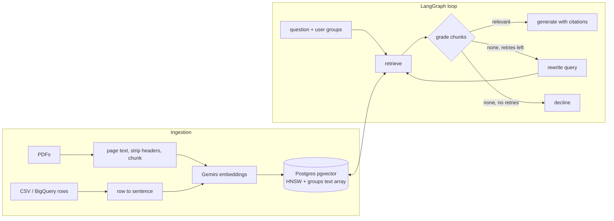

# DocBridge

An enterprise RAG pipeline that turns a folder of PDFs and tables into an access controlled question answering service.

* **Ingestion** of unstructured PDFs (page aware, boilerplate stripped, sentence aware chunks with overlap) and structured tables (CSV or a BigQuery query, one self describing chunk per row), with incremental re-ingestion by content hash.
* **PostgreSQL + pgvector** storage with an HNSW index and a `groups` column, so document level access control is enforced inside the SQL query and restricted chunks never leave the database.
* **A LangGraph corrective RAG loop**: retrieve, grade every chunk, rewrite the query and retry when nothing relevant comes back, and decline when retries run out instead of guessing.
* **An evaluation harness** reporting recall@5, MRR, answer accuracy, groundedness, refusal accuracy and access leaks on a labelled question set.

Gemini provides embeddings, grading, rewriting and answers. Without credentials, deterministic offline stand ins (a feature hashing embedder and a lexical grader) keep everything runnable and testable.



## Quick start

```bash
python -m venv .venv && source .venv/bin/activate
pip install -e ".[dev]"
python scripts/make_corpus.py        # sample corpus (already committed in corpus/)
pytest -q
docbridge ask "How much holiday do I get each year?"
docbridge ask "What is the merit budget for this salary review?" --groups all   # declined: restricted
docbridge ask "What is the merit budget for this salary review?" --groups hr    # answered
docbridge eval eval/questions.jsonl --out eval/report.md
```

### With Gemini and pgvector

```bash
docker compose up -d                 # Postgres 16 with pgvector
cp .env.example .env                 # add GOOGLE_API_KEY
set -a && source .env && set +a
docbridge ingest corpus/             # embeds with gemini-embedding-001 (768 dims) into pgvector
docbridge eval eval/questions.jsonl --out eval/report-gemini.md
```

## The sample corpus

`corpus/` holds documents for Harbourline Logistics, a fictional company, generated by `scripts/make_corpus.py`. `corpus/manifest.json` assigns reader groups to each source:

| Source | Type | Groups |
|---|---|---|
| employee_handbook.pdf | 3 page PDF | all |
| it_security_policy.pdf | 2 page PDF | all |
| travel_and_expense_policy.pdf | 2 page PDF | all |
| warehouse_sla.csv | table | all |
| compensation_guidelines.pdf | PDF | hr |
| salary_bands.csv | table | hr |
| incident_runbook.pdf | 2 page PDF | engineering |

Every user implicitly has the `all` group. A source missing from the manifest gets no groups, so it is unreadable until someone grants access.

## How it works

**Chunking.** PDF text is extracted page by page, lines that repeat on most pages (running headers and footers) are removed, short heading lines are kept as their own sentence, and text is packed into chunks of about 90 words on sentence boundaries with one sentence of overlap. Each chunk is cited as `source#page`, for example `employee_handbook.pdf#p2`. Table rows become sentences like `Warehouse service levels by site. site: Tuas; region: Singapore; dock to stock hours: 24; ...` and are cited as `warehouse_sla.csv#row:Tuas`.

**Access control.** `search()` takes the asker's groups and filters with `groups && $groups` in the same query as the vector ordering. The pgvector store turns on iterative HNSW scans (pgvector 0.8+) so a heavily filtered search still returns k rows.

**The loop** (`docbridge/graph.py`). The grader looks at each retrieved chunk against the original question. Only accepted chunks reach the generator, which must cite every sentence with a passage number. If nothing passes, the query is rewritten into policy wording and retrieval runs again, up to two times, then the system declines. The `steps` trace on every answer shows the path taken, for example `retrieve > grade:0/5 > rewrite > retrieve > grade:2/5 > generate`.

**Evaluation** (`docbridge/evaluate.py`). Each labelled question in `eval/questions.jsonl` lists gold references, the asker's groups and strings the answer must contain. Unanswerable questions include both missing information and restricted content asked by someone outside the group.

| Metric | Meaning |
|---|---|
| recall@5 | Share of answerable questions with a gold chunk in the first pass top 5 |
| mrr | Mean reciprocal rank of the first gold chunk |
| loop_recall@5 | The same, measured on the chunks the grader passed to the generator after any rewrites |
| answer_accuracy | Answer contains every expected string |
| groundedness | Share of answer sentences that cite a chunk containing most of the sentence's content words |
| refusal_accuracy | Share of unanswerable questions correctly declined |
| access_leaks | Retrieved chunks the asker is not allowed to read (must be 0) |

`eval/report-offline.md` is the baseline from the offline stand ins. The labelled set is small and was written alongside the corpus, so treat these numbers as a regression check, not a benchmark. Run with Gemini to get model based results.

## Project layout

```
docbridge/
  ingest/pdf.py       page extraction, boilerplate removal
  ingest/tables.py    CSV and BigQuery rows to chunks
  ingest/chunker.py   sentence aware chunking with overlap
  ingest/pipeline.py  manifest, incremental upsert and deletion
  embed.py            Gemini and hashing embedders
  store/pgvector.py   Postgres store: HNSW, access filter, upsert
  store/memory.py     exact search for tests
  llm.py              grade, rewrite, generate (Gemini and offline)
  graph.py            LangGraph corrective RAG loop
  evaluate.py         metrics and Markdown report
  cli.py              ingest, ask, eval
corpus/               sample documents and manifest
eval/                 labelled questions and reports
tests/                ingestion, retrieval, loop, access control, metrics, pgvector integration
```

CI runs the full test suite and the evaluation against a real pgvector service container.

## License

MIT
